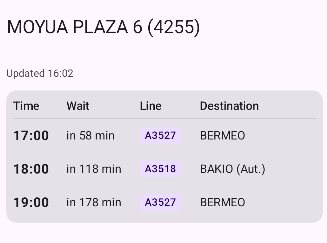

# GTFS Bus Stop

[](https://github.com/gsanmar0604/gtfs-bus-stop/actions/workflows/tests.yml)

Test task for Posimatiq. The program reads the static [GTFS](https://gtfs.org/) timetable of
**Bizkaibus** and shows the **next 3 departures** from one hard-coded bus stop in Bilbao, both
on the command line and in an Android app.

**Target Stop:** Bizkaibus stop `4255`, "MOYUA PLAZA 6". It is on Plaza Moyúa (officially
Plaza Federico Moyúa), the square that locals call **Plaza Elíptica**. The stop is
hard-coded, as the task specifies.

Written in Kotlin: a plain JVM module with all the logic and the CLI, plus an Android app
(Jetpack Compose) that reuses it.



## Features

| # | Feature | Status | Where |
|---|---|---|---|
| 1 | Basic GTFS Parsing: CLI printing the next 3 departures as Markdown | Done | `core/` |
| 2 | Static Bus Stop Info: the same departures in a graphical UI | Done | `app/` |
| 3 | Dynamic Bus Stop Info: the screen updates itself as time passes | Done (optional) | `app/` |
| 4 | Real-time updates from GTFS-rt | Out of scope (needs a Phoenix backend) | |

## Quick start

1. **Get the data.** The GTFS feed is not committed (it is large and replaced every few months).
   Download the **Bizkaibus** GTFS zip and save it as `data/bizkaibus.zip` (the `data/` folder is
   git-ignored):
   ```sh
   curl -L --create-dirs -o data/bizkaibus.zip https://ctb-gtfs.s3.eu-south-2.amazonaws.com/bizkaibus.zip
   ```
   or use the [direct link](https://ctb-gtfs.s3.eu-south-2.amazonaws.com/bizkaibus.zip) in a browser.
   If the link ever changes, the feed is listed on CTB's open data portal: <https://data.ctb.eus/dataset>.
   On Windows PowerShell, type `curl.exe` instead of `curl`.
2. **Run the tests:** `./gradlew :core:test`
3. **Run the CLI:** `./gradlew :core:run --args="data/bizkaibus.zip"`
4. **Run the app:** open the project in Android Studio and press **Run**.

On Windows, use `.\gradlew` instead of `./gradlew`. Requires JDK 21; the app also needs the
Android SDK (Android Studio installs it).

## Feature 1: command line

```sh
./gradlew :core:run --args="data/bizkaibus.zip"

# or, after unzipping data/bizkaibus.zip into data/bizkaibus/
./gradlew :core:run --args="data/bizkaibus"
```

The CLI reads the **complete** dataset, straight from the zip or from a folder. Sample output:

```markdown
## Next departures at MOYUA PLAZA 6 (4255)

| Time | Line | Destination |
|------|------|-------------|
| 16:00 | A3518 | BAKIO (Aut.) |
| 17:00 | A3527 | BERMEO |
| 18:00 | A3518 | BAKIO (Aut.) |
```

- **Time** is the real clock time (a GTFS time of `25:10:00` prints as `01:10`).
- **Line** is the route's short name. **Destination** is the trip's headsign.
- With no departures it prints `No upcoming departures.`. After the feed's last service date it
  prints `Timetable expired on <date>. Download a newer feed.` instead.
- It exits with a non-zero code and a clear message on stderr when the path is missing, the stop
  is not in the feed, or a required GTFS column is missing.

## Features 2 and 3: Android app

- Put the zip at `data/bizkaibus.zip` **before building**. The build packs a small extract of it
  into the app (see "The app's feed" below), so nothing needs to be copied to the device.
  Without the zip, the app builds but shows "GTFS feed not bundled".
- The screen shows the stop name, when it was last updated, and the next 3 departures with
  their time, a countdown ("in 4 min" / "now"), the line and the destination.
- **Live updates (feature 3):** the departures are recalculated at the start of every minute,
  so a bus disappears once its minute has passed and the countdowns tick down.
- It works offline: the timetable is inside the app.

### Building the APK without Android Studio

Requires JDK 21 and the Android SDK. Tell Gradle where the SDK is with the `ANDROID_HOME`
environment variable, or a `local.properties` file in the project root containing
`sdk.dir=<path to the SDK>` (Android Studio creates this file for you; it is git-ignored
because the path differs on each machine). Put the feed at `data/bizkaibus.zip` first: the
build packs its extract into the app.

```sh
./gradlew :app:assembleDebug
```

The APK is written to `app/build/outputs/apk/debug/app-debug.apk`. To install it on a
connected device or a running emulator:

```sh
./gradlew :app:installDebug
# or: adb install -r app/build/outputs/apk/debug/app-debug.apk
```

This is a debug build (signed with the standard debug key), fine for trying the app.
It needs Android 8.0 or later.

## Tests

All logic lives in `core/` and is unit-tested there (64 tests). GitHub Actions runs them on
every push and pull request (badge above) and reports line and branch coverage for `core`.

```sh
./gradlew :core:test
```

| Test file | What it checks |
|---|---|
| `NextDeparturesTest` (13) | Order, buses that already left, "exactly now", the limit, rolling into the next day, times past 24:00, weekday and weekend service, holidays, end of the feed, unknown stop |
| `CsvTest` (7) | BOM, quoted fields with commas, escaped quotes, header spaces, blank lines |
| `RefreshTest` (8) | Countdown minutes, wait until the next minute, departures dropping off as time passes |
| `GtfsFormatTest` (10) | Missing required columns, short rows, fallbacks for optional columns, empty times, malformed times/dates/integers |
| `MarkdownRendererTest` (4) | Exact output format, times after midnight, empty and expired cases |
| `FeedSubsetTest` (3) | The app's extract gives exactly the same departures as the full feed |
| `CalendarEdgeCasesTest` (2) | Service only from `calendar_dates.txt` (the real Bizkaibus pattern); no `calendar.txt` |
| `MidnightStoppingRuleTest` (1) | A bus at 00:45 is not missed when the previous day has trips after midnight |
| `BoardingRulesTest` (1) | Buses you can't board are skipped |
| `ExpiredFeedTest` (4) | The feed's last service date; `expiredOn` before, on, and after expiry; after-midnight departure still visible when expired |
| `GtfsZipTest` (1) | Reading from a zip and from a folder give the same result |
| `MainTest` (6) | CLI exit codes and output: no args, missing path, unknown stop, malformed feed, success, expired feed |
| `SubsetMainTest` (4) | Subset CLI: wrong arg count, missing source, malformed feed, success |

CI measures line and branch coverage for `:core` with JaCoCo and uploads the full HTML report
as a build artifact. Measured on 2026-11-15: **98.0% of lines** (288/294) and **82.8% of branches**
(207/250). The two entry-point functions (`runCli`, `runSubset`) are tested through their
`main` wrappers; the Android app is not unit-tested by design (it only displays what `core`
calculates).

Most tests use a tiny hand-written feed in `core/src/test/resources/fixtures/`; its
[README](core/src/test/resources/fixtures/README.md) lists every trip and why it is there.
The app has no unit tests of its own: it only displays what `core` calculates.

## Design notes

### Times past midnight

GTFS times count from the start of the **service day** and can exceed 24 hours: `25:10:00` on
a Thursday service means **01:10 on Friday**. Times are parsed as a `Duration`, not a clock time,
and added to the service date. Because yesterday's service can still have buses after midnight,
the search starts at **yesterday's** date.

### Which days a trip runs

A trip runs on a date if its service is active: the weekly pattern in `calendar.txt`, overridden
by the exceptions in `calendar_dates.txt` (1 = added, 2 = removed). In the real Bizkaibus feed every
weekday flag in `calendar.txt` is 0, so all service comes from `calendar_dates.txt`.

### Finding the next 3

Departures at or after "now" are collected day by day, starting yesterday. The search stops once the
next day's midnight is later than the 3rd-best departure found: a day can't produce anything earlier
than its own midnight. That rule matters around midnight, where the previous day's `24:xx`/`25:xx`
trips mix with the next day's early ones. The search also stops at the feed's last service date or
after 14 days.

### Buses you can't board

A stop time is skipped if `pickup_type` is `1` (no boarding) or if the stop is the **last stop of
the trip** (the bus ends there). Feeds don't always mark the last stop with `pickup_type = 1`, so
both are checked. Knowing whether a stop is the last one needs every row of the trip, so
`stop_times.txt` is read once, recording each trip's highest `stop_sequence`, and the rule is
applied after that single pass.

### Large file, small memory

`stop_times.txt` has about 780,000 rows. It is streamed line by line, and only the target stop's
rows are kept. Files that aren't needed (`shapes.txt`, fares) are never opened.

### The app's feed: a build-time extract

The app always shows one stop, so it doesn't need the whole timetable. At build time,
`writeStopSubset` (in `core`) writes a small zip with only the trips that serve stop 4255.
For each of those trips it keeps the stop's row **and the trip's last row**. Without that last row,
every trip would seem to end at 4255 and be skipped by the boarding rule. `FeedSubsetTest` checks
that the extract gives exactly the same departures as the full feed, including around midnight.

This cut the app's start-up from 8–10 s to about 0.8 s on the emulator. The CLI still reads the
complete dataset.

A production app would download the feed from CTB, cache it and check for updates instead of
bundling it.

### Live updates and the Android lifecycle

- The feed is loaded once and kept in the `ViewModel`. Every minute, the departures are recalculated
  from that object; the wait until the next minute is calculated from a fresh "now" each time, so the
  timer can't drift.
- The countdown is the difference between the two `HH:mm` times on screen, so it always matches them.
- The updates run as a `Flow` exposed with `stateIn(…, WhileSubscribed(5_000), …)` and collected with
  `collectAsStateWithLifecycle()`. They stop when the app goes to the background (after 5 s) and
  restart, with an immediate recalculation, when it comes back, so the screen is never out of date
  after the phone wakes. A rotation takes less than 5 s, so it doesn't restart anything. After a longer
  absence, the cached feed means there is nothing to reload.
- "Now" comes from an injected `java.time.Clock`, so the time can be fixed for checking by hand
  (for example just before midnight).

### Errors

A missing required GTFS column, a row shorter than the header, or a malformed value (bad date format,
non-numeric sequence number, time with the wrong number of parts) raises a `GtfsFormatException` that
names the file and the bad value. The CLI prints it and exits with code 1; the app shows it on screen;
the build fails if it happens while writing the app's extract. Optional columns have fallbacks: the
line label uses `route_short_name`, then `route_long_name`, then `route_id`.

### Known limitations

- The CSV reader doesn't support line breaks inside quoted fields (GTFS feeds practically never have them).
- If `data/bizkaibus.zip` is removed without `./gradlew clean`, the app keeps bundling the last extract.

## Project layout

```
core/                   JVM module: GTFS parsing, departure logic, Markdown output, CLI, unit tests
  src/main/kotlin/busstop/
    GtfsFeed.kt         loading the feed, service calendars, boarding rule, next departures
    Csv.kt              small CSV reader (BOM, quoted fields)
    GtfsSource.kt       opens a GTFS zip or folder
    FeedSubset.kt       writes the app's one-stop extract
    MarkdownRenderer.kt CLI output
    Refresh.kt          minute-based timing and countdown
    Config.kt           target stop and time zone
    Main.kt, SubsetMain.kt   command-line entry points
app/                    Android app: Compose UI and ViewModel, reuses core
data/                   the GTFS zip (git-ignored, download it yourself)
docs/                   screenshot
.github/workflows/      CI running the unit tests
```